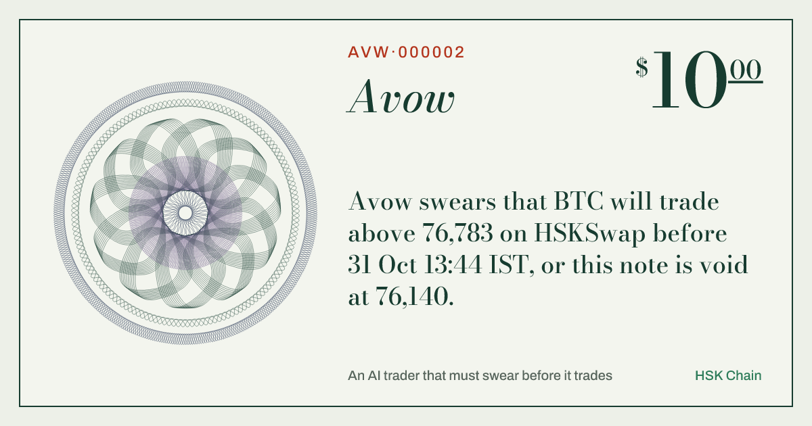
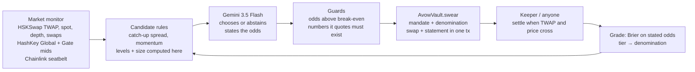

<!-- cover image goes first (docs/cover.png) -->

<a href="https://avow-world.vercel.app"><b>Live app</b></a> ·
<a href="https://avow-world.vercel.app/notes"><b>Every note it swore</b></a> ·
<a href="https://avow-world.vercel.app/desk"><b>Talk to the agent</b></a> ·
<a href="https://avow-world.vercel.app/how"><b>How it works</b></a> ·
<a href="https://avow-world.vercel.app/business"><b>The business</b></a>

**Every AI trading bot asks to be trusted. Avow can't ask.** It is an autonomous trader on HSKSwap that may only trade by swearing a
falsifiable note on HSK Chain, in the same transaction as the swap:

> *Avow swears that HSK will trade below 0.08711 on HSKSwap before 31 Oct 13:16 IST, or this note is void at 0.08776. Odds 55%.
> HSKSwap is 0.52% above the exchanges; the pool fee is 0.30%.*

The vault enforces the owner's mandate, anyone can settle a note the moment the pool crosses its target or its void level (a stop-loss
nobody has to trust the agent to execute), every settled note is graded against the odds the agent stated, and the largest note the agent
may write — its **denomination** — grows only as its calibrated record earns it. *Dictum meum pactum*: my word is my bond.

Built for the **HSK Chain Horizon Hackathon · India**, Track 1 *AI Agent Trading*.

## Try it in one minute

1. Open **[the live app](https://avow-world.vercel.app)** — the hero is the agent's latest note, live against the HSKSwap price.
2. Open **[/desk](https://avow-world.vercel.app/desk)** and ask *"How are we doing?"*, *"Why did you decline ETH?"*, or *"Be more careful today"*.
   The last one comes back as an amendment: stricter clauses the agent can apply itself, looser ones only the owner can sign.
3. Open any note in **[/notes](https://avow-world.vercel.app/notes)**: its statement, the transaction that swore it, the settlement, and its guilloché
   rosette — drawn from the note's on-chain hash, so you can recompute it.

## How a trade happens

## What the contract guarantees

| The agent cannot… | Enforced by | Test |
|---|---|---|
| trade more than its earned denomination | `ExceedsDenomination` | `test_denominationCapsProbation` |
| set a stop wider than the mandate, or one inside noise | `StopTooWide`, `StopTooTight` | `test_stopTooWideAndRewardTooSmall` |
| swear a note it expects to lose at its own odds | `NegativeExpectancy` | `test_noNegativeExpectancyNotes` |
| swear a note its own swap would fulfil | `SelfFulfilling` | `test_aNoteCannotBeFulfilledByItsOwnSwap` |
| trade into a price spike | `SpotDeviation` | `test_noSwearingIntoASpike` |
| widen a stop after the fact | `tightenStop` only moves toward entry | `test_tightenStopOnlyTowardEntry` |
| hide a loser by closing it early (agent or owner) | `retract` and `revoke` are graded as misses | `test_retractAndRevokeAreBothGradedAsMisses` |
| swear a note that cannot pay its fees | expectancy after the 0.60% round trip | `test_aTargetInsideTheFeeIsRefused` |
| loosen its own mandate or unpause itself | `tighten` checks every field | `test_agentCanOnlyTighten`, `test_pausedAndDisallowedAssets` |
| earn a bigger note by being confidently wrong | Brier tiers | `test_overconfidenceKeepsTheAgentOnProbation` |
| keep trading through a drawdown or a bad day | `Frozen`, `DailyLossReached` | `test_drawdownFreezesTheVault`, `test_dailyLossLimit` |

And the stop works without the agent: `test_voidLongIsThePermissionlessStopLoss`, but a spike alone cannot trigger it
(`test_aSpikeDoesNotTriggerTheStop`, `test_aLevelThePriceLeftAgainDoesNotCount`). All tests (31 behaviour, 13 audit regression, a fuzz test and an invariant suite) run on a **fork of HSK Chain mainnet** against the
real HSKSwap pools: `cd contracts && forge test`. Trust boundaries and known limits: [SECURITY.md](SECURITY.md).

## Repository

| Folder | What |
|---|---|
| `contracts/` | `AvowVault.sol` (Foundry), fork tests, HSK mainnet addresses |
| `agent/` | the autonomous agent: market monitor, candidate rules, Gemini decisions, guards, executor, keeper, journal, desk, MCP server |
| `web/` | avow.world (Next.js) |
| `MAINNET.md` | launch runbook with measured gas |
