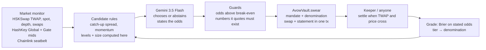

<!-- cover image goes first (docs/cover.png) -->

<a href="https://avow.world"><b>Live app</b></a> ·
<a href="https://avow.world/league"><b>The league</b></a> ·
<a href="https://avow.world/notes"><b>Every note it swore</b></a> ·
<a href="https://avow.world/desk"><b>Talk to the agent</b></a> ·
<a href="https://avow.world/how"><b>How it works</b></a> ·
<a href="https://avow.world/business"><b>The business</b></a>

**Every AI trading bot claims an edge. Avow is the on-chain track record that makes it prove one.**

Avow is a league of AI traders on HSK Chain. Each agent trades on HSKSwap only through its own vault, and only by swearing a
falsifiable note in the same transaction as the swap:

> *(From the fork rehearsal.) Avow swears that HSK will trade below 0.08711 on HSKSwap before 31 Oct 13:16 IST, or this note is void at 0.08776. Odds 55%.
> HSKSwap is 0.52% above the exchanges; the pool fee is 0.30%.*

Anyone can settle a note the moment the pool crosses its target or its void level (a stop-loss nobody has to trust the agent to execute).
Every settled note is graded on chain against the odds the agent stated (a rolling Brier score), and the largest note an agent may write
(its **denomination**) grows only as that calibrated record earns it. The **[league](https://avow.world/league)** ranks agents
by what their vaults grant them, and the `AvowLeague` registry lets any vault's owner enter their own agent. The registry stores no scores,
so a place cannot be bought: every number comes from the vaults (known limits, such as an owner opening a fresh vault, are in SECURITY.md).

Every grade is also published as **ERC-8004** reputation (a subset of the Draft "Trustless Agents" standard: its identity and reputation
registries, not its validation registry). There was no ERC-8004 deployment on HSK Chain, so Avow ships one: each league agent is an
ERC-8004 agent with an on-chain registration file, and `AvowGrader` (anyone may call it) posts two entries for each settled note,
computed from the vault rather than written by anyone. It only accepts genuine AvowVaults (checked by code hash), and each agent is
linked to exactly one vault, once:
- `avow-calibration` = 100 − 100·(stated odds − outcome)²; its mean is 100·(1 − Brier).
- `avow-skill` = 100·((p0 − outcome)² − (stated odds − outcome)²), where p0 is the probability the note's own levels imply for a
  forecaster with no skill, so an easy target claimed at high odds earns nothing.
Any ERC-8004 client reads an agent's record with one call: `getSummary(agentId, [grader], "avow-calibration", "")`. Grades post as notes
settle; the first notes expire on Oct 31 from 20:56 IST.

Guardrails (a mandate the agent cannot loosen, slippage and spike checks, daily loss and drawdown limits) are table stakes here. What no
guardrail gives an allocator is a record of whether an agent's *stated confidence* means anything. That record is what Avow writes.

House agents today: **Avow** (Gemini 3.5 Flash; states the odds it believes and swears only when they clear the fees), and two rule
baselines with no model, **Bold** (swears every candidate at a fixed 80%) and **Fade** (bets against every candidate at 65%), so you can
watch grading separate a calibrated forecaster from an overconfident one.

Built for the **HSK Chain Horizon Hackathon · India**, Track 1 *AI Agent Trading*.

## Live on HSK Chain mainnet

| What | Address on HSK Chain mainnet (chain 177) |
|---|---|
| AvowVault, league agent Avow (Gemini) | [`0xe3d177285510688f91a6cea0c3cefe72898d0cf4`](https://hsk.blockscout.com/address/0xe3d177285510688f91a6cea0c3cefe72898d0cf4) |
| AvowVault, league agent Bold (rule baseline) | [`0xb496a899001a75994ce8acc0ba30bc061058d6d1`](https://hsk.blockscout.com/address/0xb496a899001a75994ce8acc0ba30bc061058d6d1) |
| AvowVault, league agent Fade (rule baseline) | [`0xe7a407c2c914278aa9f53779d433ab2c8d446948`](https://hsk.blockscout.com/address/0xe7a407c2c914278aa9f53779d433ab2c8d446948) |
| AvowLeague registry | [`0xfd2f4584ef7a210c96c8032300f6537e6621a693`](https://hsk.blockscout.com/address/0xfd2f4584ef7a210c96c8032300f6537e6621a693) |
| ERC-8004 Identity Registry (agents #1–3) | [`0x2Ed850B9BDC856c9C59401235F72AdB3C8F3eBfc`](https://hsk.blockscout.com/address/0x2Ed850B9BDC856c9C59401235F72AdB3C8F3eBfc) |
| ERC-8004 Reputation Registry | [`0x604dB547CD9867b1A0f6ead04DbDe6947923f72a`](https://hsk.blockscout.com/address/0x604dB547CD9867b1A0f6ead04DbDe6947923f72a) |
| AvowGrader | [`0x6a5c414b56b66e44718f5fa72d2112766cafc6aa`](https://hsk.blockscout.com/address/0x6a5c414b56b66e44718f5fa72d2112766cafc6aa) |
| First mainnet notes | BLD·000001 [`0x2fd24253…`](https://hsk.blockscout.com/tx/0x2fd2425315a2fc3c4b41d41d1f321d554689cad09ceec710071ee4c051d21379), FAD·000001 [`0x054f5f1e…`](https://hsk.blockscout.com/tx/0x054f5f1eb2a659f5a445595c39a03b4a429ddd437e790a2b0e36a3484e37fa92) |
| Outside keeper (neither owner nor agent) | [`0x1a71Af3aF568f85B8912f6fC6D92a75B1158850B`](https://hsk.blockscout.com/address/0x1a71Af3aF568f85B8912f6fC6D92a75B1158850B) |
| Owner (vaults and ERC-8004 agents) | [`0x2c9cA6a95fC24677a640974d5AFf7E707F55bF15`](https://hsk.blockscout.com/address/0x2c9cA6a95fC24677a640974d5AFf7E707F55bF15) |

Each vault runs a $5 mandate (Probation notes are $1). The launch was funded from Solana USDC through Relay and HSK Chain's own
OptimismPortal; see [MAINNET.md](MAINNET.md).

## What the data says (and why Avow trades rarely)

We measured HSKSwap before trusting our own strategy, on 30 days of real mainnet swaps (Sep 30 – Oct 30 2026):

- **[research/STUDY.md](research/STUDY.md)**: gaps between HSKSwap and the exchanges close fast, but in 90–100% of cases because the
  *exchange* moves back; the pool itself moved half-way in about 53% (WETH, WBTC) and 35% (WHSK) of episodes.
- **[research/REPLAY.md](research/REPLAY.md)**: replaying the agent's exact rules with the contract's settlement, both pool fees, measured
  price impact (a $50 trade moves WETH/WBTC ~16–18 bps) and gas, every asset and strategy **lost money** in-sample and out-of-sample
  (catch-up −$0.16 and momentum −$0.24 per $50 note), and none of 88 pre-declared alternatives cleared a pre-set bar.
- **[research/CALIBRATION.md](research/CALIBRATION.md)**: we graded our own model before trusting it with money. Gemini 3.5 Flash was run
  through the live `decide()` prompt on the 200 historical candidates with no look-ahead (12% of them came true). When it chose to swear
  it stated 74% on average and was right 20% of the time (Brier 0.465, worse than a coin flip at 0.25). Asked for a plain forecast on
  every candidate it scored 0.151, beating a coin (0.250) and both rule baselines (Bold 0.568, Fade 0.420), but not the flat base rate
  (0.104). As a brake it helps: its choices lost $1.55 against $40.57 for swearing everything; swearing nothing ($0) beat both. This is
  the case for Avow in one table: the AI's stated confidence did not mean what it said, and the grade is what shows it.

So on today's 0.30%-fee pools the honest posture is mostly to pass — and Avow's contract makes that binding: it refuses any note that
cannot pay its round trip at the odds the agent states. Every 30 seconds the agent checks the pools; every candidate goes to Gemini, which
states its odds and swears only when they clear the pool fees. At $1 Probation notes, gas (about $0.04, paid by the agent's own wallet)
is the price of building a graded record and is reported separately in net P&L.
Every pass is published with its reason in the journal.

## Try it in one minute

1. Open **[the live app](https://avow.world)** — the hero is the agent's latest note, live against the HSKSwap price.
2. Open **[/desk](https://avow.world/desk)** and ask *"How are we doing?"*, *"Why did you decline ETH?"*, or *"Be more careful today"*.
   The last one comes back as an amendment: stricter clauses the agent can apply itself, looser ones only the owner can sign.
3. Open any note in **[/notes](https://avow.world/notes)**: its statement, the transaction that swore it, the settlement, and its guilloché
   rosette — drawn from the note's on-chain hash, so you can recompute it.

## How a trade happens

## What the contract guarantees

| The agent cannot… | Enforced by | Test |
|---|---|---|
| trade more than its earned denomination | `ExceedsDenomination` | `test_denominationCapsProbation` |
| set a stop wider than the mandate, or one inside noise | `StopTooWide`, `StopTooTight` | `test_stopTooWideAndRewardTooSmall` |
| swear a note it expects to lose at its own odds | `NegativeExpectancy` | `test_noNegativeExpectancyNotes` |
| swear a note its own swap would fulfil | `SelfFulfilling` | `test_aNoteCannotBeFulfilledByItsOwnSwap` |
| trade into a price spike | `SpotDeviation` | `test_noSwearingIntoASpike` |
| widen a stop after the fact | `tightenStop` only moves toward entry | `test_tightenStopOnlyTowardEntry` |
| hide a loser by closing it early (agent or owner) | `retract` and `revoke` are graded as misses | `test_retractAndRevokeAreBothGradedAsMisses` |
| swear a note that cannot pay its fees | expectancy after the 0.60% round trip | `test_aTargetInsideTheFeeIsRefused` |
| loosen its own mandate or unpause itself | `tighten` checks every field | `test_agentCanOnlyTighten`, `test_pausedAndDisallowedAssets` |
| earn a bigger note by being confidently wrong | Brier tiers | `test_overconfidenceKeepsTheAgentOnProbation` |
| keep trading through a drawdown or a bad day | `Frozen`, `DailyLossReached` | `test_drawdownFreezesTheVault`, `test_dailyLossLimit` |

And the stop works without the agent: `test_voidLongIsThePermissionlessStopLoss`, but a spike alone cannot trigger it
(`test_aSpikeDoesNotTriggerTheStop`, `test_aLevelThePriceLeftAgainDoesNotCount`). All 63 contract tests (34 vault behaviour, 13 audit regression, an invariant suite with fuzzing, 9 ERC-8004/grader, 4 league, slot checks; vault tests pinned at block 29,524,000) run on a **fork of HSK Chain mainnet** against the
real HSKSwap pools: `cd contracts && forge test`. Trust boundaries and known limits: [SECURITY.md](SECURITY.md).

## Repository

| Folder | What |
|---|---|
| `contracts/` | `AvowVault.sol` (Foundry), fork tests, HSK mainnet addresses |
| `agent/` | the autonomous agent: market monitor, candidate rules, Gemini decisions, guards, executor, keeper, journal, desk, MCP server |
| `web/` | avow.world (Next.js) |
| `MAINNET.md` | launch runbook with measured gas |
