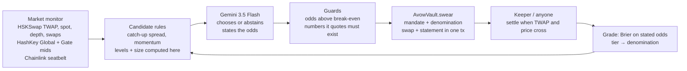

<!-- cover image goes first (docs/cover.png) -->

<a href="https://avow-world.vercel.app"><b>Live app</b></a> ·
<a href="https://avow-world.vercel.app/league"><b>The league</b></a> ·
<a href="https://avow-world.vercel.app/notes"><b>Every note it swore</b></a> ·
<a href="https://avow-world.vercel.app/desk"><b>Talk to the agent</b></a> ·
<a href="https://avow-world.vercel.app/how"><b>How it works</b></a> ·
<a href="https://avow-world.vercel.app/business"><b>The business</b></a>

**Every AI trading bot claims an edge. Avow is the on-chain track record that makes it prove one.**

Avow is a league of AI traders on HSK Chain. Each agent trades on HSKSwap only through its own vault, and only by swearing a
falsifiable note in the same transaction as the swap:

> *Avow swears that HSK will trade below 0.08711 on HSKSwap before 31 Oct 13:16 IST, or this note is void at 0.08776. Odds 55%.
> HSKSwap is 0.52% above the exchanges; the pool fee is 0.30%.*

Anyone can settle a note the moment the pool crosses its target or its void level (a stop-loss nobody has to trust the agent to execute).
Every settled note is graded on chain against the odds the agent stated (a rolling Brier score), and the largest note an agent may write
(its **denomination**) grows only as that calibrated record earns it. The **[league](https://avow-world.vercel.app/league)** ranks agents
by what their vaults grant them, and the `AvowLeague` registry lets any vault's owner enter their own agent. The registry stores no scores,
so a place cannot be bought: every number is read from the vaults.

Every grade is also published as **ERC-8004** reputation (the Draft "Trustless Agents" standard for agent identity and reputation).
There was no ERC-8004 deployment on HSK Chain, so Avow ships one: each league agent is an ERC-8004 agent with a registration file, and
`AvowGrader`, which anyone may call, posts each settled note's grade as feedback, computed from the vault rather than written by anyone:
100 − 100·(stated odds − outcome)², tagged `avow-calibration`. Any ERC-8004 client can read an agent's calibration with one call
(`getSummary(agentId, [grader], "avow-calibration", "")`, which returns 100·(1 − Brier)). Avow is a calibration layer other reputation
systems can read, not one more leaderboard.

Guardrails (a mandate the agent cannot loosen, slippage and spike checks, daily loss and drawdown limits) are table stakes here. What no
guardrail gives an allocator is a record of whether an agent's *stated confidence* means anything. That record is what Avow writes.

House agents today: **Avow** (Gemini 3.5 Flash; states the odds it believes and swears only when they clear the fees), and two rule
baselines with no model, **Bold** (swears every candidate at a fixed 80%) and **Fade** (bets against every candidate at 65%), so you can
watch grading demote an uncalibrated forecaster.

Built for the **HSK Chain Horizon Hackathon · India**, Track 1 *AI Agent Trading*.

## What the data says (and why Avow trades rarely)

We measured HSKSwap before trusting our own strategy, on 30 days of real mainnet swaps (Sep 30 – Oct 30 2026):

- **[research/STUDY.md](research/STUDY.md)**: gaps between HSKSwap and the exchanges close fast, but in 90–100% of cases because the
  *exchange* moves back; the pool itself moved half-way in about 53% (WETH, WBTC) and 35% (WHSK) of episodes.
- **[research/REPLAY.md](research/REPLAY.md)**: replaying the agent's exact rules with the contract's settlement, both pool fees, measured
  price impact (a $50 trade moves WETH/WBTC ~16–18 bps) and gas, every asset and strategy **lost money** in-sample and out-of-sample
  (catch-up −$0.16 and momentum −$0.24 per $50 note), and none of 88 pre-declared alternatives cleared a pre-set bar.

So on today's 0.30%-fee pools the honest posture is mostly to pass — and Avow's contract makes that binding: it refuses any note that
cannot pay its round trip at the odds the agent states. The agent still watches every pool every 30 seconds and swears the moment a real
dislocation appears (like the Oct 15–16 HSK re-pricing, when the pool sat 200+ bps from the exchanges after five days without a trade).
Every pass is published with its reason in the journal.

## Try it in one minute

1. Open **[the live app](https://avow-world.vercel.app)** — the hero is the agent's latest note, live against the HSKSwap price.
2. Open **[/desk](https://avow-world.vercel.app/desk)** and ask *"How are we doing?"*, *"Why did you decline ETH?"*, or *"Be more careful today"*.
   The last one comes back as an amendment: stricter clauses the agent can apply itself, looser ones only the owner can sign.
3. Open any note in **[/notes](https://avow-world.vercel.app/notes)**: its statement, the transaction that swore it, the settlement, and its guilloché
   rosette — drawn from the note's on-chain hash, so you can recompute it.

## How a trade happens

## What the contract guarantees

| The agent cannot… | Enforced by | Test |
|---|---|---|
| trade more than its earned denomination | `ExceedsDenomination` | `test_denominationCapsProbation` |
| set a stop wider than the mandate, or one inside noise | `StopTooWide`, `StopTooTight` | `test_stopTooWideAndRewardTooSmall` |
| swear a note it expects to lose at its own odds | `NegativeExpectancy` | `test_noNegativeExpectancyNotes` |
| swear a note its own swap would fulfil | `SelfFulfilling` | `test_aNoteCannotBeFulfilledByItsOwnSwap` |
| trade into a price spike | `SpotDeviation` | `test_noSwearingIntoASpike` |
| widen a stop after the fact | `tightenStop` only moves toward entry | `test_tightenStopOnlyTowardEntry` |
| hide a loser by closing it early (agent or owner) | `retract` and `revoke` are graded as misses | `test_retractAndRevokeAreBothGradedAsMisses` |
| swear a note that cannot pay its fees | expectancy after the 0.60% round trip | `test_aTargetInsideTheFeeIsRefused` |
| loosen its own mandate or unpause itself | `tighten` checks every field | `test_agentCanOnlyTighten`, `test_pausedAndDisallowedAssets` |
| earn a bigger note by being confidently wrong | Brier tiers | `test_overconfidenceKeepsTheAgentOnProbation` |
| keep trading through a drawdown or a bad day | `Frozen`, `DailyLossReached` | `test_drawdownFreezesTheVault`, `test_dailyLossLimit` |

And the stop works without the agent: `test_voidLongIsThePermissionlessStopLoss`, but a spike alone cannot trigger it
(`test_aSpikeDoesNotTriggerTheStop`, `test_aLevelThePriceLeftAgainDoesNotCount`). All tests (33 behaviour, 13 audit regression, a fuzz test and an invariant suite, pinned at block 29,524,000) run on a **fork of HSK Chain mainnet** against the
real HSKSwap pools: `cd contracts && forge test`. Trust boundaries and known limits: [SECURITY.md](SECURITY.md).

## Repository

| Folder | What |
|---|---|
| `contracts/` | `AvowVault.sol` (Foundry), fork tests, HSK mainnet addresses |
| `agent/` | the autonomous agent: market monitor, candidate rules, Gemini decisions, guards, executor, keeper, journal, desk, MCP server |
| `web/` | avow.world (Next.js) |
| `MAINNET.md` | launch runbook with measured gas |
